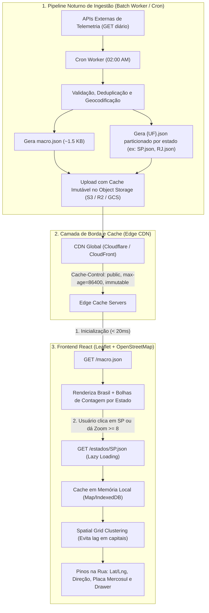

# Especificação Arquitetural: Sistema de Gestão Cartográfica de Frotas com Telemetria Diária

> **Documento de Arquitetura e Engenharia de Software**  
> **Destinatário:** Equipe de Engenharia / Assistente AI (Claude)  
> **Autor / Baseline:** Antigravity Architect  
> **Versão:** 1.0.0  
> **Data:** Outubro de 2026  

---

## 1. Visão Geral e Restrições de Negócio

### 1.1. O Problema
Desenvolvimento de uma feature cartográfica para um **Sistema de Gestão de Frotas Corporativas**, integrando dados de telemetria externa para exibir a localização exata de cada veículo na rua em sua última posição registrada do dia.

### 1.2. Premissas e Restrições Críticas
1. **Frequência de Atualização:** **1 vez ao dia (Diário)**. Não é um mapa de tracking em tempo real (não há WebSockets nem polling a cada 5 segundos). O dado é **estático e imutável durante o ciclo de 24 horas**.
2. **Zero Google Maps / Zero Ferramentas Pagas:** Não utilizar Google Maps, Mapbox ou CartoDB autenticado com planos pagos ou cartões de crédito. A solução deve utilizar **Leaflet + OpenStreetMap Oficial** (ou tiles locais/self-hosted), sem necessidade de API Keys externas proprietárias.
3. **Escala e Densidade:** Suporte a frotas com dezenas de milhares de veículos no Brasil, com tratamento inteligente de altíssima densidade em capitais (como São Paulo e Rio de Janeiro), sem sobrecarregar o DOM ou travar o navegador.
4. **Transição Macro para Micro:**
   - **Visão Macro (Zoom-Out / Brasil):** Exibe o mapa completo do país com as divisas dos 27 estados (UF) e um marcador/bolha de contagem agregada de veículos em cada estado.
   - **Visão Micro (Zoom-In / Nível de Rua):** Ao ultrapassar o limiar de zoom (`zoom >= 8`) ou clicar em um estado específico, carrega sob demanda os veículos georreferenciados na via exata onde pararam ou transitaram.

---

## 2. Decisão de Arquitetura: *Hierarchical Static Snapshot Pattern*

### 2.1. Por que NÃO fazer dump geral (1 único GET com tudo)?
- Um JSON com 30.000 a 50.000 veículos com metadados (placa, condutor, telemetria, endereço, lat/long) pesa entre 8 MB e 18 MB.
- Causaria um *cold-start* péssimo: o usuário ficaria de 3 a 6 segundos aguardando o download e parsing do JavaScript antes de ver qualquer pixel na tela.
- Desperdício massivo de banda de rede para gestores que operam frotas regionais (ex: gestor do RJ não precisa das coordenadas de 10.000 veículos de SP no primeiro carregamento).

### 2.2. Por que NÃO fazer queries dinâmicas de Bounding Box (`bbox`) no Banco a cada movimento?
- Como a posição dos veículos **não muda durante o dia**, executar queries espaciais no banco de dados (ex: PostGIS `ST_Contains`) a cada arrasto de mapa consome CPU desnecessária de banco de dados e introduz latência de rede em algo previsível.

### 2.3. A Arquitetura Recomendada (Padrão Ouro de Engenharia)
Aproveitamos a **imutabilidade de 24 horas** dos dados para criar uma arquitetura de **Custo Praticamente Zero**, com latências abaixo de 20ms e escala infinita:



---

## 3. Módulo de Backend: Pipeline Noturno de Ingestão (Cron Job)

### 3.1. Agendador (Cron)
- **Horário:** Rodar em horário de menor tráfego (ex: `0 3 * * *` - 03:00 da manhã no fuso local).
- **Função:** Buscar o consolidado diário dos provedores externos de telemetria, validar os dados e publicar os artefatos estáticos.

### 3.2. Passos do Pipeline do Worker
1. **Extração:** Dispara os GETs nas APIs dos parceiros externos de telemetria para obter a última posição conhecida de cada veículo.
2. **Tratamento e Normalização:**
   - Garantir que `lat` e `lng` sejam números flutuantes válidos dentro do território brasileiro (ex: latitude entre -33.7 e 5.2, longitude entre -73.9 e -34.7).
   - Normalizar placa no padrão Mercosul/Convencional.
   - Atribuir o estado federativo (`UF`) através de geocodificação reversa ou do cadastro do veículo.
3. **Agregação do `macro.json`:**
   - Conta a quantidade de veículos por estado (`SP`, `RJ`, `MG`, etc.).
   - Calcula os KPIs gerais da frota (Total, Em Trânsito/Rota, Parados/Pátio, Em Manutenção).
4. **Particionamento por Estado (`{UF}.json`):**
   - Agrupa os registros em arquivos individuais (ex: `SP.json`, `RJ.json`, `MG.json`).
5. **Publicação no Storage:**
   - Envia os arquivos para um bucket de Object Storage (**AWS S3**, **Cloudflare R2**, **Google Cloud Storage** ou pasta pública de CDN).
   - Aplica compressão **Gzip** ou **Brotli**.
   - Define o cabeçalho HTTP:
     ```http
     Cache-Control: public, max-age=86400, stale-while-revalidate=3600, immutable
     Content-Type: application/json; charset=utf-8
     ```

---

## 4. Contratos de Dados (JSON Schemas)

### 4.1. Visão Macro: `macro.json`
- **Tamanho aproximado:** ~1.5 KB
- **Tempo de resposta:** ~15ms
```json
{
  "data_corte": "2026-10-07T00:00:00Z",
  "versao_telemetria": "2026.10.07-v1",
  "total_frota": 14850,
  "kpis": {
    "em_rota": 7120,
    "parados": 6800,
    "manutencao": 930
  },
  "estados": [
    { "uf": "SP", "nome": "São Paulo", "veiculos": 6800, "lat": -22.19, "lng": -48.79 },
    { "uf": "RJ", "nome": "Rio de Janeiro", "veiculos": 2400, "lat": -22.25, "lng": -42.66 },
    { "uf": "MG", "nome": "Minas Gerais", "veiculos": 1900, "lat": -18.10, "lng": -44.38 },
    { "uf": "PR", "nome": "Paraná", "veiculos": 1100, "lat": -24.89, "lng": -51.55 }
  ]
}
```

### 4.2. Visão Micro por Estado: `{UF}.json` (ex: `SP.json`)
Para economizar tráfego móvel e processamento, as chaves do array de veículos podem ser compactadas:
- **Tamanho aproximado:** ~40 KB a 90 KB compactado com Brotli para 3.000 veículos.
```json
{
  "uf": "SP",
  "data_corte": "2026-10-07T00:00:00Z",
  "veiculos": [
    {
      "id": "VEH-SP-0042",
      "p": "BRA2E19",
      "lat": -23.561400,
      "lng": -46.656000,
      "h": 145,
      "v": 52,
      "s": "in_transit",
      "cat": "truck",
      "mod": "Volvo FH 540 6x4T",
      "mot": "Carlos Eduardo Silva",
      "tel": "(11) 98765-4321",
      "odo": 148920,
      "comb": 78,
      "bat": 98,
      "end": "Av. Paulista, 1578 - Bela Vista, São Paulo - SP",
      "hora_transmissao": "06:45"
    }
  ]
}
```
**Legenda dos campos compactos:**
- `p`: Placa do Veículo
- `lat` / `lng`: Coordenadas decimais exatas da última posição
- `h`: Heading / Sentido de direção em graus (0 a 360) para desenhar a seta de orientação
- `v`: Velocidade no momento do corte (km/h)
- `s`: Status operacional (`in_transit`, `parked`, `depot`, `maintenance`)
- `cat`: Categoria (`truck`, `van`, `car`, `motorcycle`)
- `mod`: Modelo e Ano
- `mot`: Nome do Motorista / Condutor
- `odo`: Odômetro diário acumulado
- `comb`: Nível de Combustível em %
- `end`: Endereço georreferenciado legível da via pública

---

## 5. Estratégia de Frontend (React + Leaflet + OpenStreetMap)

### 5.1. Camadas do Mapa sem Dependências Proprietárias
- **Provedor de Tiles Oficial:** OpenStreetMap Foundation
  - URL dos Tiles: `https://tile.openstreetmap.org/{z}/{x}/{y}.png`
  - Subdomínios: Nenhum obrigatório
  - Custo / Chave: **Zero API Keys**, gratuito e aberto.
- **Filtro Dark Mode Nativo via CSS:**
  Para manter o visual escuro de dashboard tecnológico sem depender de serviços externos que cobram planos comerciais (como o CartoDB), aplica-se um filtro CSS sobre os tiles:
  ```css
  .leaflet-dark-tiles {
    filter: brightness(0.68) invert(100%) hue-rotate(180deg) contrast(1.25) saturate(0.85) !important;
  }
  ```

### 5.2. Máquina de Estados da Transição Macro/Micro
1. **Estado Inicial (Zoom 3 a 7):**
   - Baixa apenas o `macro.json`.
   - Renderiza os `L.divIcon` estilizados nos centróides de cada estado com a contagem total.
   - Nenhum pino de veículo individual existe no DOM (CPU e memória zeradas).
2. **Gatilho de Zoom-In (Zoom >= 8 ou Clique no Estado):**
   - Identifica o estado alvo (`UF`).
   - Verifica se os veículos daquele estado já estão no cache local do cliente (`memoryCache.has(uf)`).
   - Se não estiverem, faz o `GET /estados/{UF}.json`.
   - Salva no cache local.
3. **Clustering Espacial Inteligente (Altas Densidades em Capitais):**
   - **Zoom 8 a 14:** Agrupa veículos geograficamente próximos em células de grade de 50px a 60px. Renderiza bolhas de cluster com contagem (ex: "São Paulo Centro: 142").
   - **Zoom 15 a 19 (Nível de Rua):** Desativa o agrupamento e projeta o veículo com precisão sobre o asfalto da rua, exibindo placa Mercosul e seta direcional.

---

## 6. Prompt para o Claude (Instruções de Implementação)

Copie e envie o bloco abaixo para o Claude dar sequência na implementação:

```markdown
Olá Claude! Estou implementando um sistema de gestão de frotas com visualização em mapa de telemetria diária (sem Google Maps, usando Leaflet e OpenStreetMap).

Por favor, analise a especificação técnica abaixo e me ajude com as seguintes tarefas:

1. [Backend/Worker]: Escreva um script/worker em Node.js (ou Python) que simula o cron job diário de agregação:
   - Recebe uma base de veículos com latitude, longitude, placa e telemetria.
   - Gera o arquivo `macro.json` com os totais de cada estado brasileiro.
   - Gera os arquivos particionados `{UF}.json` (ex: `SP.json`, `RJ.json`) compactados para armazenamento em bucket S3/R2.

2. [Backend/API]: Configure os endpoints HTTP (Express, Fastify ou FastAPI) ou regras de bucket estático para servir:
   - `GET /api/frotas/macro` (retorna o macro.json com cabeçalhos de cache de 24h).
   - `GET /api/frotas/estados/:uf` (retorna o JSON daquele estado sob demanda).

3. [Frontend Integration]: Crie o hook customizado em React (`useFleetTelemetry`) que:
   - Gerencia a requisição do macro.json na inicialização.
   - Faz o lazy-loading dos estados conforme o usuário navega pelo mapa.
   - Mantém um cache em memória (IndexedDB ou Map) para evitar requisições repetidas para a mesma UF no mesmo dia.

Por favor, siga rigorosamente a premissa de que a telemetria é diária (1x ao dia, dados imutáveis por 24h), usando a arquitetura particionada por UF descrita no documento.
```

---

## 7. Conclusão dos Benefícios da Arquitetura

| Métrica | Abordagem Tradicional (Dump / Banco Direto) | Nossa Arquitetura (Hierarchical Snapshot) |
| :--- | :--- | :--- |
| **Custo de APIs de Mapa** | US$ 500 a US$ 3.000 / mês (Google Maps) | **US$ 0,00** (OpenStreetMap + Leaflet) |
| **Custo de Banco de Dados** | Alto (Milhares de queries espaciais ao dia) | **US$ 0,00** (Zero queries do front no banco) |
| **Tempo de Carregamento Inicial** | 3 a 7 segundos (Payload pesado) | **< 50 milissegundos** (Payload de 1.5 KB) |
| **Experiência ao Dar Zoom** | Travamentos e re-queries no servidor | **Instantâneo (60 FPS)** com cache local |
| **Escalabilidade Simultânea** | Limitada pela capacidade de conexões do banco | **Infinita** (Arquivos estáticos servidos via CDN) |
